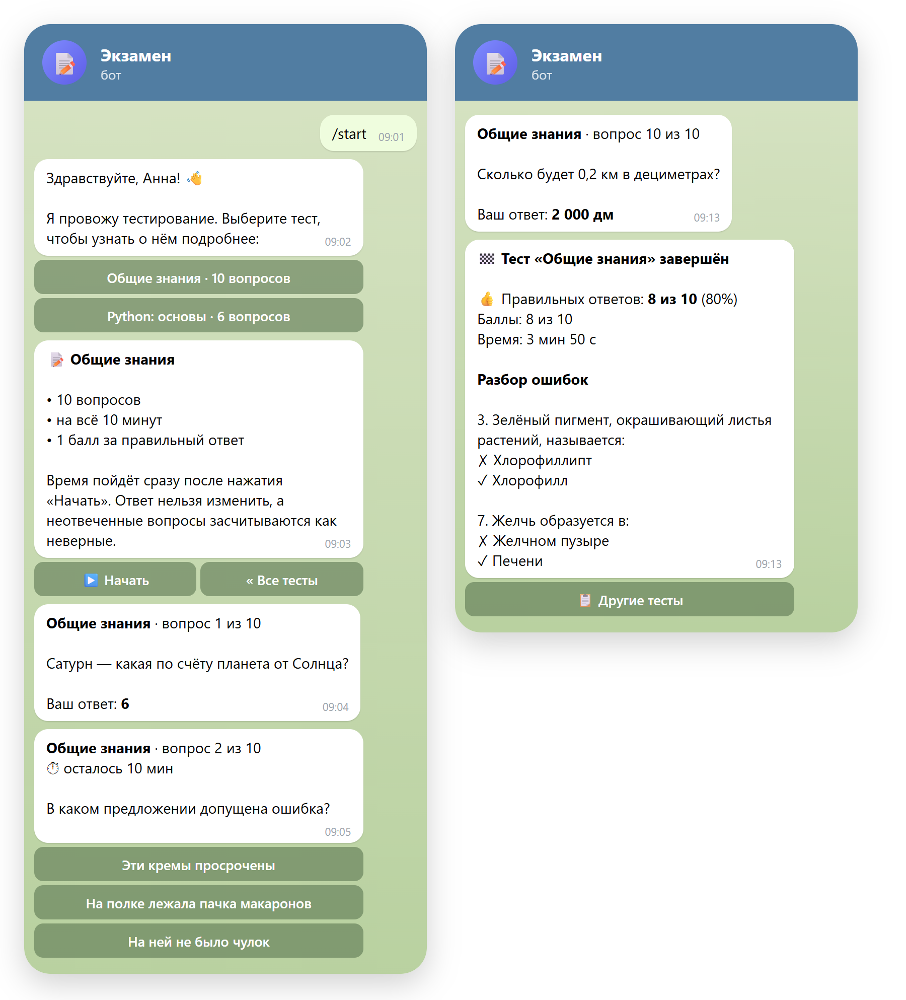
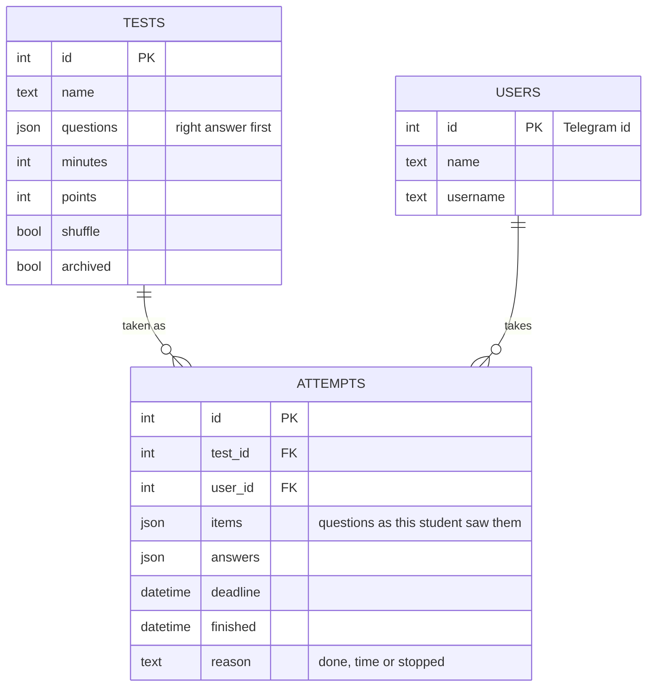

<div align="center">

# 📝 telexam

**A Telegram bot for timed multiple-choice tests.**

Students pick a test, answer questions with buttons against the clock and
get their score with every mistake explained. Admins upload tests as JSON
files and download the results for Excel.

[](https://github.com/mredwardlik/telexam/actions/workflows/tests.yml)




</div>

---

## ✨ Features

- 📋 **Several tests**, each with its own time limit and points per answer
- 🎲 **Shuffled answers** for every student, and shuffled questions if the
  test asks for it, so neighbours don't see the same order
- ⏱ **Time limit for the whole test**: every question shows the time left,
  and when it is over the bot finishes the test on its own and sends the
  result, even if the student stopped answering
- 🔒 **Fair answers**: an answer can't be changed, old buttons don't work,
  and a late answer is not counted
- 🧾 **Results with explanations**: score, percent, points, time spent and
  every mistake with the right answer. `/results` shows past attempts
- 💾 **Nothing is lost**: tests, students and attempts live in SQLite, so a
  restart of the bot doesn't break a test that is in progress
- 👩‍🏫 **Admin tools in the chat**: upload a test as a `.json` file, see
  statistics, download results as CSV for Excel, hide a test
- 🖥 **And in the terminal**: `telexam add`, `list`, `results --csv`, `delete`

## 🚀 Quick start

1. Create a bot with [@BotFather](https://t.me/BotFather) and copy its token.
2. Copy `config.example.env` to `config.env` and fill it in:

   ```ini
   TOKEN=123456789:AAH...xyz
   ADMINS=123456789          # your Telegram id, from @userinfobot
   DATABASE=telexam.db
   ```

3. Install, add the example tests and run:

   ```bash
   pip install git+https://github.com/mredwardlik/telexam.git
   telexam add examples/general.json examples/python.json
   telexam
   ```

On Windows, `start.bat` does all of it: it makes a virtual environment on the
first run, adds the examples and starts the bot. Python 3.10 or newer.

Every setting can also be an environment variable, which is handy on a
server: `TOKEN=... ADMINS=... telexam`.

## 🧾 Writing a test

A test is a JSON file. **The first answer of every question is the correct
one**; the bot shuffles them for each student.

```json
{
  "name": "Общие знания",
  "minutes": 10,
  "points": 1,
  "shuffle": true,
  "questions": {
    "Единица измерения силы тока — это:": ["Ампер", "Вольт", "Ватт"],
    "Сатурн — какая по счёту планета от Солнца?": ["6", "7", "8"]
  }
}
```

| Key         | Meaning                                      | Default  |
| ----------- | -------------------------------------------- | -------- |
| `name`      | the name shown to students, unique           | required |
| `questions` | question → answers, the right one first      | required |
| `minutes`   | time for the whole test, 1–1440              | `30`     |
| `points`    | points for each right answer, 1–100          | `1`      |
| `shuffle`   | shuffle the order of questions too           | `false`  |

A question has 2 to 10 answers. Answers longer than 32 characters are
listed in the message and the buttons show their numbers. Questions can also
be a list: `[{"question": "...", "answers": ["...", "..."]}]`.

Send the file to the bot as an admin, or run `telexam add file.json`. A file
with the name of an existing test updates it; attempts that were already
made keep their own copy of the questions, so old results stay correct.
Two examples are in [`examples/`](examples).

## 💬 Commands

| Command    | Who      | What it does                                         |
| ---------- | -------- | ---------------------------------------------------- |
| `/start`   | everyone | greeting and the list of tests, or the test in progress |
| `/tests`   | everyone | the list of tests                                    |
| `/results` | everyone | the last 10 results                                  |
| `/finish`  | everyone | finish the current test early, after a confirmation  |
| `/help`    | everyone | the list of commands                                 |
| `/stats`   | admins   | attempts, average and best result of every test, CSV buttons |
| `/add`     | admins   | the test format; then just send a `.json` file       |
| `/delete`  | admins   | hide a test from the list, its results stay          |

From the terminal:

```bash
telexam                              # run the bot
telexam check                        # check the settings and list the tests
telexam add examples/*.json          # add tests, --replace updates existing ones
telexam list                         # tests with the number of attempts
telexam results "Общие знания"       # results in the terminal
telexam results --csv results.csv    # all results for Excel
telexam delete "Общие знания"        # hide a test
```

## 🗄 Data model



## 🗂 Project layout

```
telexam/
├── exam.py       tests, users and attempts in SQLite; time limit and scoring
├── bot.py        Telegram handlers, buttons and the timer
├── texts.py      everything the bot says
├── settings.py   config.env and environment variables
└── cli.py        the telexam command
examples/         two example tests
tests/            the exam, the bot against a fake Telegram API, the command
```

## 🧪 Tests

```bash
pip install -e ".[dev]"
pytest
```

The bot is tested against a fake Telegram API and a clock that the tests
move by hand, so whole tests are taken, time runs out and results are
checked without a network. GitHub Actions runs them on Python 3.10–3.14 on
Ubuntu and on Windows.

## 📄 License

[MIT](LICENSE)
