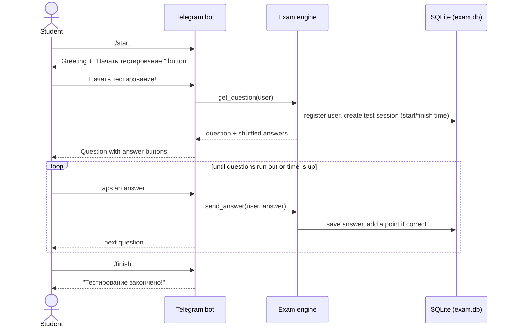
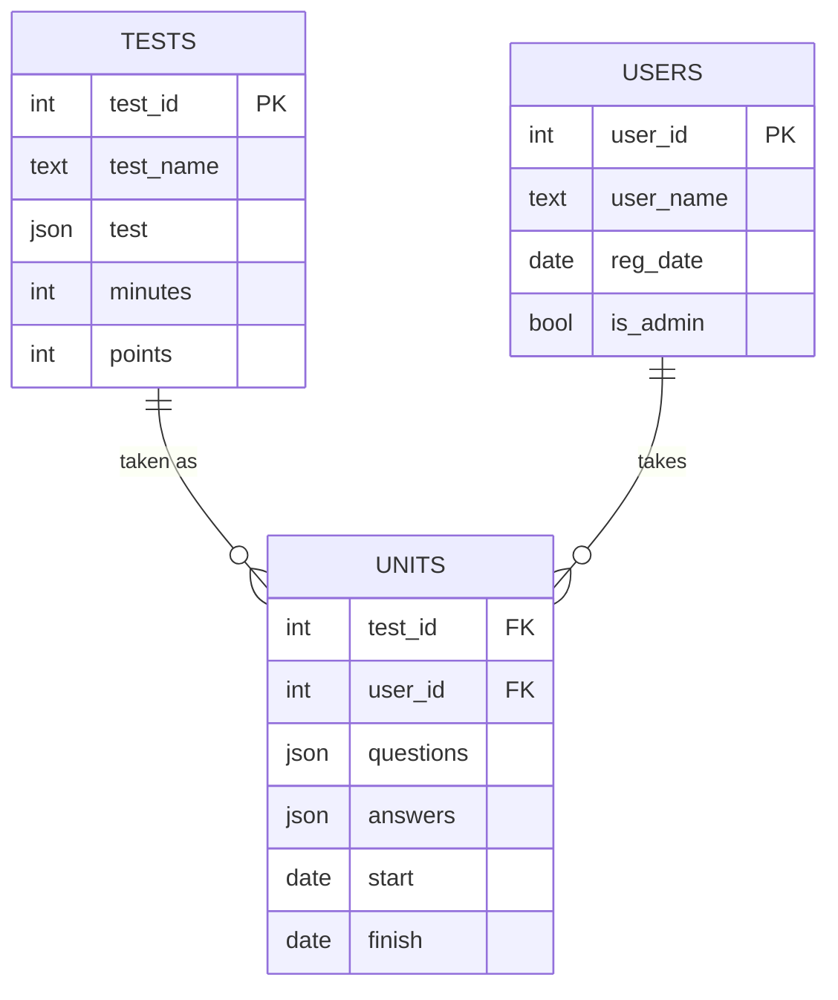

<div align="center">

# 📝 telexam

**A Telegram bot for timed multiple-choice tests.**

Students take a quiz right in Telegram: the bot sends questions with answer
buttons, keeps time and counts points. Tests and results are stored in SQLite.


</div>

---

> [!NOTE]
> This is an **unfinished prototype** from 2020. The bot logic and database
> layer were being rewritten, and the current code doesn't run yet. The README
> describes the idea and the planned design.

## 💡 Idea



## ✨ Planned features

- 📋 **Several tests**: each with its own name, time limit and points per
  question
- 🎲 **Shuffled answers**: answer buttons are shown in random order
- ⏱ **Time limit**: each session has `start` and `finish` time (30 minutes by
  default)
- 👤 **Users and admins**: registration on first contact and an admin flag for
  managing tests
- 💾 **Saved progress**: questions and answers of every session are stored in
  SQLite, so a restart doesn't lose them

## 🧾 Test format

A test is a plain dictionary: the key is a question, and the value is a list of
answers where **the first answer is the correct one**. The bot shuffles the
answers before showing them.

```python
test = {
    "Единица измерения силы тока - это:": ["Ампер", "Вольт", "Ватт"],
    "Сколько хромосом в геноме человека?": ["46", "42", "44"],
}

TestManager("exam.db").add_test(name="Test 1", test=test, time=30, point=1)
```

## 🗄 Data model



A **unit** is one attempt by one user at one test.

## 🗂 Project structure

```text
telexam/
├── telexam.py   # bot entry point: sample test, Telegram handlers (commented out for now)
├── exam.py      # Database / ExamDatabase (SQLite), Exam engine, TestManager
└── exam.db      # SQLite database (early schema)
```

## 🗺 Roadmap

- [ ] Finish the `Exam` engine: sessions, scoring, time limit
- [ ] Finish `TestManager`: add, change and delete tests
- [ ] Turn the Telegram handlers back on in `telexam.py`
- [ ] Admin commands for uploading tests and viewing results
- [ ] Move the bot token to an environment variable (`token.txt` is used now)
